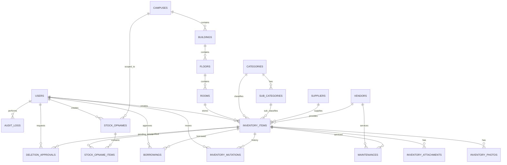

# ERD — Sistem Inventaris UNDIRA

## Diagram Relasi



## Format Nomor Inventaris

```
UND-{KAMPUS}-{GEDUNG}-L{LANTAI}-{RUANGAN}-{KATEGORI}-{SEQ}
Contoh: UND-CBB-A-L3-A302-MJ-0001
```

## Normalisasi (3NF)

- **1NF:** Semua kolom atomic
- **2NF:** Lokasi dinormalisasi ke campus → building → floor → room
- **3NF:** Supplier, vendor, kategori terpisah

## Soft Delete

campuses, buildings, floors, rooms, categories, sub_categories, suppliers, vendors, inventory_items, borrowings
